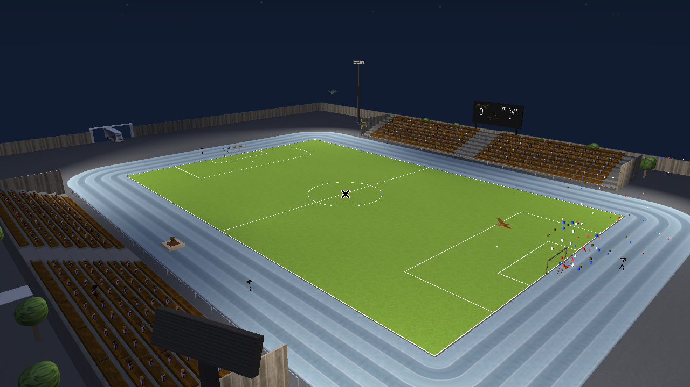
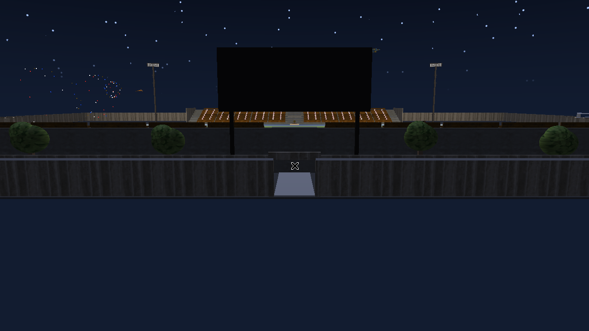
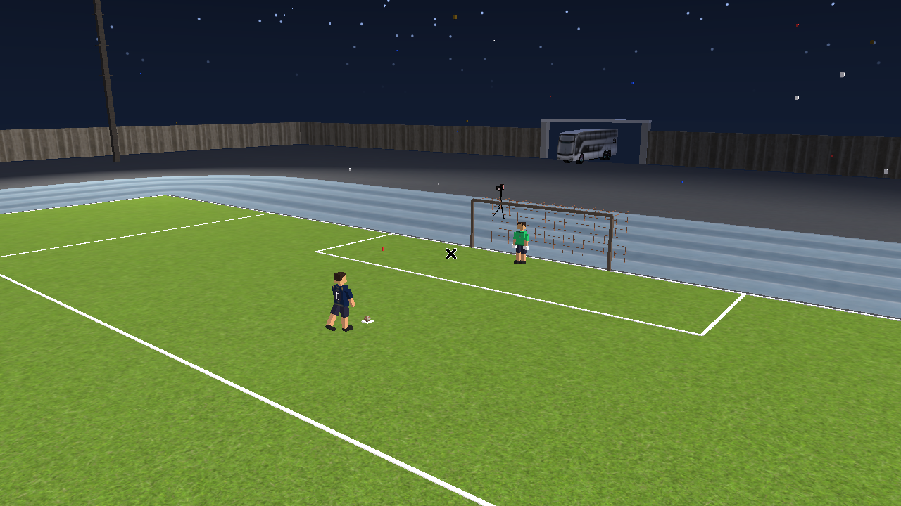

# Estadio de fútbol en OpenGL 3.3 — Pumas vs Atlante

Proyecto final del Laboratorio de Computación Gráfica (UNAM). Recrea un estadio
nocturno interactivo con cancha, pista, gradas, fachada, público, autobuses,
cámaras, drones y una secuencia de partido: llegada, saque, goles, penales y
celebración con fuegos artificiales. Está desarrollado en C++ y OpenGL 3.3.



| Vista del estadio | Secuencia del partido |
| --- | --- |
|  |  |

## Cómo ejecutar en Linux

Necesitas una tarjeta gráfica y controladores con **OpenGL 3.3** o superior. En
Ubuntu/Debian, desde la raíz del repositorio instala el compilador y las
bibliotecas necesarias y compila:

```bash
sudo apt update
sudo apt install build-essential pkg-config libglfw3-dev libglew-dev libglm-dev libassimp-dev
cd Configinicial
./build.sh
./graficaLaboratorio
```

`build.sh` compila SOIL2 (incluido en el proyecto) y genera el ejecutable Linux
`Configinicial/graficaLaboratorio`; **no ejecuta el `.exe` de Windows**. Ejecuta
el programa desde `Configinicial/`: `Shader/` y `Models/` se cargan con rutas
relativas. Para volver a abrirlo después de compilar: `cd Configinicial &&
./graficaLaboratorio` desde la raíz del repositorio.

## Cómo ejecutar en Windows

### Requisitos

- Windows de 64 bits.
- Tarjeta gráfica compatible con **OpenGL 3.3** o superior y sus controladores instalados y actualizados.
- La carpeta completa del programa: el ejecutable, las DLL y los recursos incluidos en `dist\graficaLaboratorio`.

Para usar el ejecutable incluido no necesitas instalar Visual Studio, MSYS2 ni un compilador.

### Opción 1: desde el Explorador de archivos

1. Descarga el repositorio con **Code → Download ZIP** en GitHub, o clónalo con Git.
2. Si descargaste el ZIP, haz clic derecho sobre él y selecciona **Extraer todo**.
3. Abre la carpeta del proyecto y entra en `dist\graficaLaboratorio`.
4. Haz doble clic en **`graficaLaboratorio.exe`** para iniciar el estadio.

### Opción 2: desde PowerShell

Abre PowerShell en la carpeta raíz del proyecto (la que contiene este `README.md`) y ejecuta:

```powershell
.\dist\graficaLaboratorio\graficaLaboratorio.exe
```

### Controles básicos

| Tecla | Acción |
| --- | --- |
| `1` y `2` | Vistas de los drones. |
| `3` a `8` | Cámaras fijas de transmisión. |
| `9` | Vista aérea cenital del estadio. |
| `0` | Activar la cámara libre. |
| `W`, `A`, `S`, `D` y ratón | Mover y orientar la cámara libre. |
| `Espacio` | Desde el inicio reproduce toda la secuencia; después la pausa o reanuda. |
| `L` | Reiniciar la secuencia automática. |
| `N` | Ir a la tanda de penales. |
| `P` | Tirar un penal. |
| `R` | Reiniciar el partido. |
| `Escape` | Cerrar el programa. |

### Compartir el programa

Copia o comprime **toda la carpeta `dist\graficaLaboratorio`** y extráela en el otro equipo antes de ejecutarlo. Mantén las DLL y las carpetas `Models` y `Shader` junto al `.exe`: son necesarias para cargar las bibliotecas, los modelos, las texturas y los shaders.

### Solución de problemas

- **Falta una DLL:** vuelve a extraer o copiar la carpeta completa del programa; comprueba que las DLL estén junto al ejecutable.
- **No aparecen modelos o texturas, o hay errores al cargar shaders:** comprueba que las carpetas `Models` y `Shader` conserven su contenido y estén junto al `.exe`.
- **No se abre la ventana o aparece un error de OpenGL:** actualiza los controladores de la tarjeta gráfica y verifica que el equipo soporte OpenGL 3.3.
- **La cámara no se mueve:** pulsa `0` para activar la cámara libre antes de usar `W/A/S/D` y el ratón.
- **Linux: no compila o faltan bibliotecas:** instala los paquetes indicados arriba y ejecuta `./build.sh` desde `Configinicial/`.

## Código fuente

El código fuente está en `Configinicial/`. Para todos los controles y la
descripción técnica, consulta el [manual de usuario y técnico](Manual_graficaLaboratorio.pdf).
Consulta [requisitos y pendientes](PENDIENTES_PROYECTO.md) para el estado de la entrega.

**Nota sobre la compilación:** el script `build-windows.ps1` mencionado en [EJECUTABLE.md](EJECUTABLE.md) no está incluido en este repositorio. Las instrucciones anteriores utilizan el ejecutable ya generado en `dist\graficaLaboratorio`.
